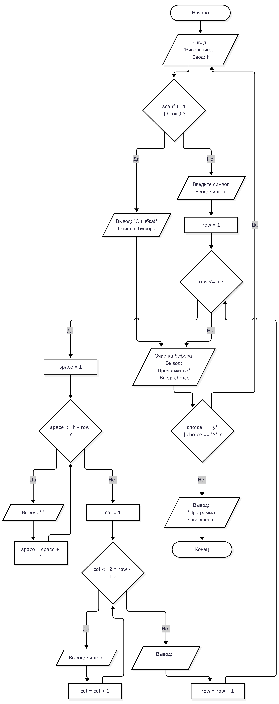

# Лабораторная работа № 9
## 1. Условие задачи, 6 Вариант
равнобедренный треугольник

 

## 2. Реализация программы
```
#define _CRT_SECURE_NO_WARNINGS
#include <stdio.h>
#include <windows.h> // не работает #include <locale.h>


void draw_isosceles_triangle(int h, char symbol);


int main(void)
{
    SetConsoleOutputCP(65001);
    char choice;
    do {
        int h = 0;
        char symbol;
        printf("\nРисование равнобедренного треугольника\n");
        printf("Введите высоту треугольника (h > 0): ");
        if (scanf("%d", &h) != 1 || h <= 0) {
            printf("Ошибка! Высота должна быть положительным числом.\n");
            while (getchar() != '\n');
            goto ask_continue;
        }
        printf("Введите символ для рисования (например, *): ");
        scanf(" %c", &symbol);
        draw_isosceles_triangle(h, symbol);
    ask_continue:
        while (getchar() != '\n');
        printf("\nПродолжить? (Да - y, нет - n): ");
        scanf("%c", &choice);

    } while (choice == 'y' || choice == 'Y');
    printf("\nПрограмма завершена.\n");
    system("pause");
    return 0;
}


void draw_isosceles_triangle(int h, char symbol)
{
    int row, space, col;
    for (row = 1; row <= h; row = row + 1)
    {
        for (space = 1; space <= h - row; space = space + 1)
        {
            printf(" ");
        }

        for (col = 1; col <= (2 * row - 1); col = col + 1)
        {
            printf("%c", symbol);
        }
        printf("\n");
    }
}
```

## 3. Результаты работы программы

Рисование равнобедренного треугольника
Введите высоту треугольника (h > 0): 32
Введите символ для рисования (например, *): -
                               -
                              ---
                             -----
                            -------
                           ---------
                          -----------
                         -------------
                        ---------------
                       -----------------
                      -------------------
                     ---------------------
                    -----------------------
                   -------------------------
                  ---------------------------
                 -----------------------------
                -------------------------------
               ---------------------------------
              -----------------------------------
             -------------------------------------
            ---------------------------------------
           -----------------------------------------
          -------------------------------------------
         ---------------------------------------------
        -----------------------------------------------
       -------------------------------------------------
      ---------------------------------------------------
     -----------------------------------------------------
    -------------------------------------------------------
   ---------------------------------------------------------
  -----------------------------------------------------------
 -------------------------------------------------------------
---------------------------------------------------------------

Продолжить? (Да - y, нет - n): y

Рисование равнобедренного треугольника
Введите высоту треугольника (h > 0): *
Ошибка! Высота должна быть положительным числом.


Продолжить? (Да - y, нет - n): y

Рисование равнобедренного треугольника
Введите высоту треугольника (h > 0): 8
Введите символ для рисования (например, *): *
       *
      ***
     *****
    *******
   *********
  ***********
 *************
***************

Продолжить? (Да - y, нет - n): n

Программа завершена.
Press any key to continue . . .


## 4. Информация о разработчике

 Воропаева Дарья БИД-261
